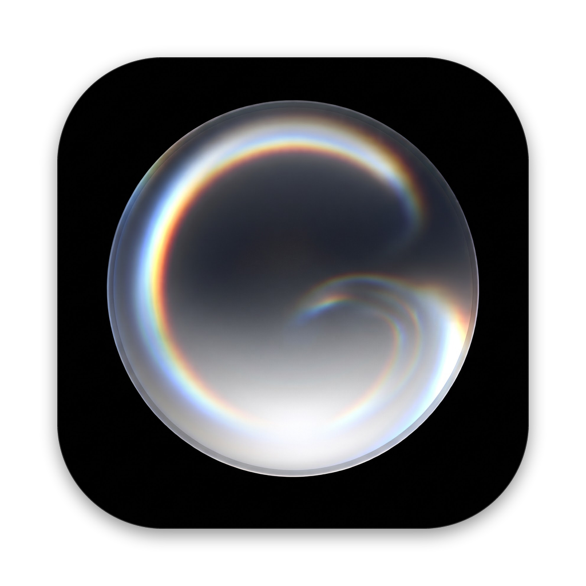

<p align="center">
  
</p>

<h1 align="center">Genesis</h1>

<p align="center">
  A study companion for your Mac that plans your day from your classes, checks your work, and keeps you company while you study.
</p>

<p align="center">
  <a href="../../releases/latest"><strong>Download for Mac</strong></a> ·
  <a href="#getting-started">Getting started</a> ·
  <a href="#plugins">Plugins</a> ·
  <a href="PRIVACY.md">Privacy</a> ·
  <a href="CONTRIBUTING.md">Contributing</a>
</p>

---

> **Beta.** Genesis is being tested by a small group of students. Canvas support currently covers **UCF Webcourses**. Expect rough edges, and please [report what you find](../../issues/new/choose).

## What it does

- **Plans today for you.** Genesis reads what's due and what's coming (exams, quizzes, assignments), works out which topics you haven't mastered yet, and paces them so nothing piles up the night before.
- **Writes practice in your professor's format**, checks it with a separate model, and keeps the answers private until you've tried.
- **Checks your work** against a rubric, including photos and PDFs of handwritten work. Answers you fix the same day count as repaired, and answers you got with a hint count as supported, so your progress is honest.
- **One box for every answer.** Type, drop in a PDF or screenshot of your iPad notes, or use the paperclip to choose a file or take a photo, scan or sketch straight from your iPhone or iPad.
- **A companion that feels like a friend.** The heart of Genesis: a small living orb that shows up on its own, when you're stuck, about to drift, done for the day, or just to check in. Every appearance starts with a choice (talk, or not now), and you lead every conversation. Its light gathers into a face that follows the moment. Need quiet? Turn it off in **Settings** for an hour, until tomorrow, or until you turn it back on.
- **Rapid-fire notes from your phone.** "Missed class." "Test moved to Friday." "Quiz covers 4.2." Your plan reshapes around them. Nothing to set up: it starts working the first time you send a note.

## Plugins

Plugins are the places Genesis gathers what it needs to build your brief: assignments, documents, dates and announcements. Each one is off until you add it, and it never runs or collects anything if you don't. You pick them on first launch and can change them any time in **Settings › Plugins**. (The companion and iPhone notes are part of Genesis itself, not plugins.)

| Plugin | What it adds |
| --- | --- |
| **Canvas** | Builds your plan from your classes: assignments, announcements, files and grades, read-only, through Genesis's own browser. |
| **Calendar** | Your private Webcourses calendar feed, for dates that only show up there. |
| **Email** | Course emails, searchable in Library (read-only). |
| **Professor websites** | Public course pages some professors keep outside Canvas. |

## Getting started

**Requirements:** a Mac with Apple silicon, macOS 15 or later, and your own [Codex](https://github.com/openai/codex) installation signed in to your OpenAI account. Genesis uses your account for its AI work; it doesn't bundle any model or credentials.

1. Download **Genesis-for-Mac** from the [latest release](../../releases/latest), unzip it, and drag **Genesis** to Applications. The app is signed and notarized by Apple.
2. On first launch, add the plugins you want.
3. In **Settings › Models**, choose your Codex executable and click **Test connection**.
4. If you added Canvas: in **Settings › Accounts**, add each class (its code, a name, and the number after `/courses/` in its Canvas URL), then **Sign in to Canvas**.
5. Click **Sync**. Your first plan takes a few minutes.

**On iPhone:** [get the Genesis beta](docs/IPHONE.md) to send notes from class. The first note you send is all the setup there is.

## Privacy

Your study records stay on your Mac, in `~/Library/Application Support/Genesis`. Genesis has no servers, accounts or analytics. Course material is sent to OpenAI only through your own Codex session when Genesis writes or checks practice. Full details are in [PRIVACY.md](PRIVACY.md).

## Building from source

```sh
git clone https://github.com/itwasVega/genesis.git
cd genesis
```

1. **Python runtime.** Genesis runs its backend on a relocatable Python 3.12. Download an `aarch64-apple-darwin` *install_only* build of CPython 3.12 from [python-build-standalone](https://github.com/astral-sh/python-build-standalone/releases) and extract it so that `Mac/Runtime/bin/python3` exists.
2. **Generate the projects:**
   ```sh
   python3 Mac/generate_project.py      # Mac/GenesisMac.xcodeproj
   python3 generate_ios_project.py      # iOS/Genesis.xcodeproj
   ```
3. Open `Mac/GenesisMac.xcodeproj` (scheme **Genesis Mac**) in Xcode 26 or later. The Debug scheme uses its own bundle ID and a throwaway workspace in `Mac/Build/FreshWorkspace`, so it never touches a real install.
4. To sign with your own team, change `DEVELOPMENT_TEAM` and the bundle IDs in the two generator scripts.

### Tests

The planner, grader, notes and companion logic are covered by tests that run without network access or models:

```sh
python3 tests/test_engine.py
python3 tests/test_policies.py
Mac/Runtime/bin/python3 Mac/Tests/check_backend.py   # needs the runtime from step 1
```

## Project layout

```
Mac/Source/            SwiftUI app: Today, tasks, the answer box, plugins, the companion and its Metal orb
Mac/Backend/outputs/   Python backend: planner, Canvas collection, grading, notes, companion
Mac/Resources/         Icons, fonts (OFL), KaTeX (MIT) and third-party notices
Mac/Tests/             Runtime and backend checks
iOS/                   The iPhone companion app for rapid-fire notes
tests/                 Offline tests with a synthetic fixture
docs/                  How it fits together
```

See [docs/ARCHITECTURE.md](docs/ARCHITECTURE.md) for how the pieces talk to each other.

## Contributing

Bug reports, ideas and pull requests are welcome. Start with [CONTRIBUTING.md](CONTRIBUTING.md), and please follow the [Code of Conduct](CODE_OF_CONDUCT.md). Security issues go through [SECURITY.md](SECURITY.md), not public issues.

## License

[MIT](LICENSE). Third-party components keep their own licenses, listed in [Mac/Resources/ThirdPartyNotices.txt](Mac/Resources/ThirdPartyNotices.txt).

Genesis is an independent project. It is not affiliated with or endorsed by the University of Central Florida, Instructure (Canvas), OpenAI or Apple.
